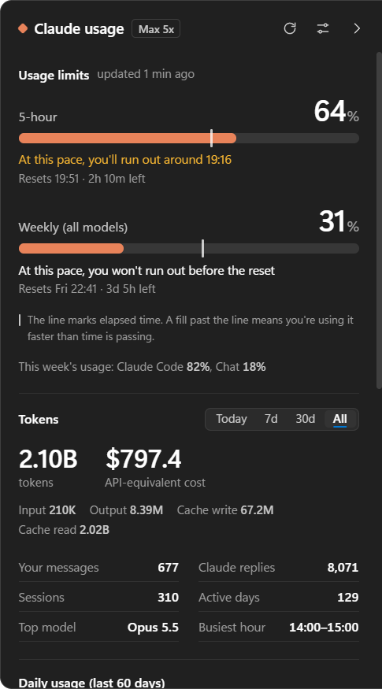
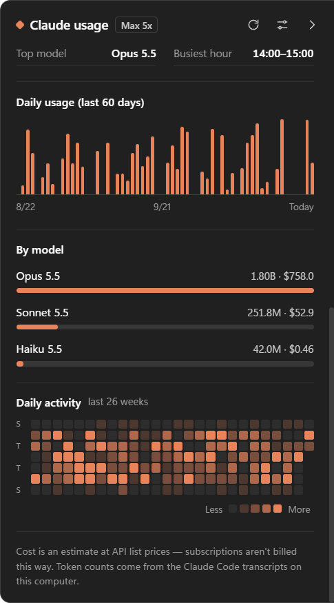
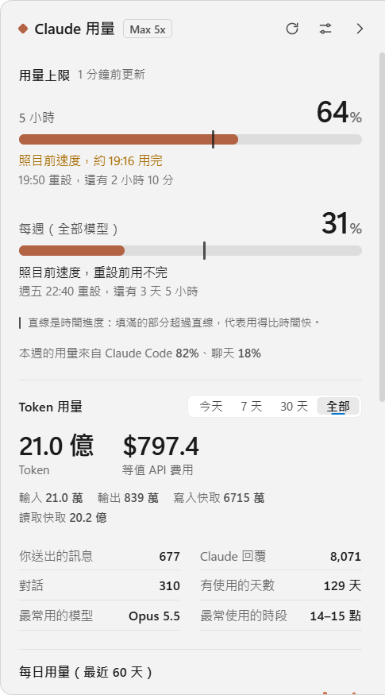
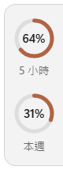

# Claude Usage HUD

**English** · [繁體中文](#繁體中文)

A small panel that lives on the right edge of your Windows screen and shows how much of your Claude plan you've used — your 5-hour and weekly limits, whether you're on pace to run out, and your Claude Code token usage.

<p>
  
  
  
</p>

*(Screenshots use demo data.)*

## Download & use

1. **Install [Claude Code](https://claude.com/claude-code) and sign in once** — run `claude` in a terminal and log in with your Claude account (Pro, Max, Team…). The HUD reads that login; you don't sign in again.
2. Download **`ClaudeUsageHUD-…-win-x64.zip`** from [**Releases**](https://github.com/andyk9885-ux/claude-usage-hud/releases/latest) and unzip it.
3. Double-click **`ClaudeUsageHUD.exe`** and choose **Install**. It copies itself to your user Programs folder, adds Start menu and desktop shortcuts, and appears in *Settings → Apps* so you can uninstall it. No administrator rights needed. You can delete the downloaded folder afterwards.
   *(Or choose **Just run it** to use it straight from the folder.)*
4. The panel opens once so you can see it. After that, **move your mouse to the right edge of the screen** — a thin glowing handle — and the tab slides out. Click it to open the full panel; click anywhere else to close it.

> If Windows shows *“Windows protected your PC”*, click **More info → Run anyway**. The app isn't code-signed (that costs money); `ClaudeUsageHUD.exe` is the unmodified official Electron runtime, renamed.

**Requirements:** Windows 10/11 (64-bit) and Claude Code signed in with a Claude subscription. If you only use Claude Code with an API key there are no plan limits to show, but token statistics still work.

## What it shows

- **Usage limits with a pace line** — each limit (5-hour, weekly) has a bar plus a line marking how much of the window has passed. If the fill is ahead of the line you're using it faster than time is passing, and it tells you roughly when you'd run out.
- **Tokens** for today / 7 days / 30 days / all time, with the API-equivalent cost (an estimate at list prices — subscriptions aren't billed this way).
- Daily usage chart, usage by model, and a 26-week activity heatmap.
- **Edge handle** colored by your 5-hour usage: your color normally, amber when high, red (blinking) when almost out.

**Settings** (slider icon, top right): start with Windows · language (follow system / 中文 / English) · appearance (follow system / light / dark) · accent color (7 presets or any custom color).

## Privacy

Everything stays on your computer. The only network request is to Anthropic's usage endpoint (`api.anthropic.com/api/oauth/usage`), made with your existing Claude Code login, every 5 minutes. The login file is only read, never modified. Token statistics come from Claude Code's local transcripts (`~/.claude/projects`).

This is an unofficial community project, not affiliated with Anthropic. The usage endpoint is undocumented and may change.

---

## 繁體中文

停在 Windows 螢幕右側邊緣的小面板，顯示 Claude 方案用了多少：5 小時和每週上限、照目前速度會不會提早用完，以及 Claude Code 的 Token 用量。

<p>
  
  
</p>

*（截圖使用示範資料。）*

### 下載與使用

1. **安裝 [Claude Code](https://claude.com/claude-code) 並登入一次**：在終端機執行 `claude`，用你的 Claude 帳號（Pro、Max、Team…）登入。這個程式直接讀取那份登入資訊，不用再登入一次。
2. 到 [**Releases**](https://github.com/andyk9885-ux/claude-usage-hud/releases/latest) 下載 **`ClaudeUsageHUD-…-win-x64.zip`** 並解壓縮。
3. 雙擊 **`ClaudeUsageHUD.exe`**，選 **安裝**。程式會把自己複製到你的使用者程式資料夾、建立開始功能表和桌面捷徑，並出現在「設定 → 應用程式」裡，可以從那裡解除安裝。不需要系統管理員權限，安裝完下載的資料夾就可以刪掉。
   （也可以選 **不安裝，直接執行**，從資料夾直接使用。）
4. 第一次會自動展開面板讓你看到它。之後**把滑鼠移到螢幕右側邊緣**的發光細把手，小標籤就會滑出；點一下展開完整面板，點面板以外的地方就會收回。

> 如果 Windows 跳出「Windows 已保護您的電腦」，按 **其他資訊 → 仍要執行**。這個程式沒有程式碼簽章（簽章要付費）；`ClaudeUsageHUD.exe` 是原封不動、只改了檔名的官方 Electron 執行檔。

**需求：** Windows 10／11（64 位元），以及用 Claude 訂閱方案登入的 Claude Code。只用 API 金鑰的話沒有方案上限可顯示，但 Token 統計照常運作。

### 功能

- **用量上限配速計**：每個上限（5 小時、每週）都有一條用量條，加上一條代表「時間已經過了多少」的直線。填滿的部分超過直線，代表用得比時間快，會告訴你大約幾點會用完。
- **Token 用量**：今天／7 天／30 天／全部，附等值 API 費用（用 API 牌價估算的參考值，訂閱方案不會照這個收費）。
- 每日長條圖、各模型用量、26 週活動熱力圖。
- **邊緣把手**依 5 小時用量變色：平常是主色，偏高變黃，快用完變紅並閃爍。

**設定**（右上角滑桿圖示）：開機自動啟動、語言（跟隨系統／中文／English）、外觀（跟隨系統／淺色／深色）、主色（7 種預設或自訂任何顏色）。

### 隱私

所有資料都留在你的電腦上。唯一的網路連線是每 5 分鐘用你現有的 Claude Code 登入查詢一次 Anthropic 的用量介面（`api.anthropic.com/api/oauth/usage`）。登入檔只讀取、不修改。Token 統計來自 Claude Code 在本機的對話紀錄（`~/.claude/projects`）。

這是非官方的社群專案，與 Anthropic 無關。用量介面沒有公開文件，之後可能變動。

---

## Development · 開發

```bash
npm install
npm start             # run from source · 直接執行
npm run demo          # run with demo data · 用示範資料執行
npm run pack          # build to dist/Claude Usage HUD · 打包
npm run install-app   # install the build on this PC · 安裝打包結果
npm run release       # build + zip for GitHub Releases · 產生發布用 zip
```

| | |
|---|---|
| `src/main.js` | window, tray, timers, settings · 視窗、系統匣、定時更新、設定 |
| `src/limits.js` | usage-limit API · 查詢用量上限 |
| `src/local-usage.js` | scans Claude Code transcripts (incremental, cached) · 掃描本機對話紀錄 |
| `src/pricing.js` | per-model prices for the cost estimate · 各模型價格 |
| `src/installer.js` | built-in install / uninstall · 內建安裝與解除安裝 |
| `src/ui/` | panel UI; all text is in `i18n.js` · 介面，文字都在 `i18n.js` |

**Don't edit the exe's icon or version info** (electron-packager / rcedit). Windows Smart App Control trusts files by fingerprint; a modified exe has a brand-new fingerprint and gets blocked. `scripts/build.js` copies the official `electron.exe` untouched and only renames it.
**不要修改 exe 的圖示或版本資訊**：Windows「智慧型應用程式控制」依檔案指紋判斷信譽，改過的 exe 會被擋下。

Test switches · 測試用環境變數: `HUD_DEMO=1` demo data · `HUD_SHOT=<dir>` take screenshots and quit · `HUD_OFFLINE=1` skip the limits API (it rate-limits hard) · `HUD_THEME=light|dark` · `HUD_LANG=zh|en`.

The usage cache and settings live in `%APPDATA%\claude-hud-zh\`.
用量快取和設定存在 `%APPDATA%\claude-hud-zh\`。

## License

[MIT](LICENSE)
